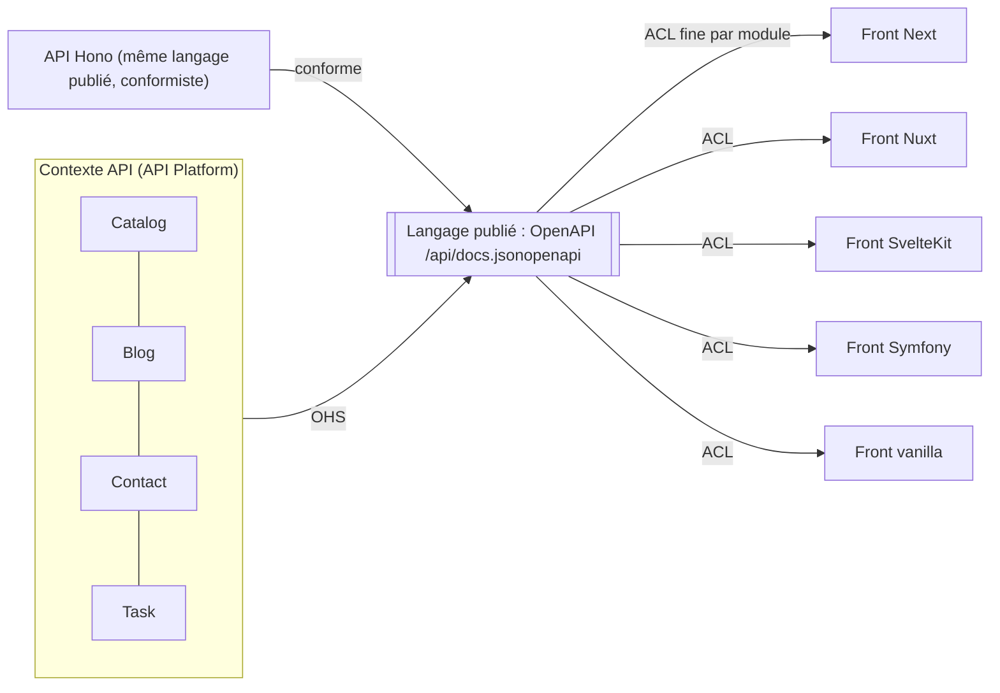

# Proposition d'architecture DDD pour les sept dépôts

**Statut** : ACCEPTÉE, recommandations D1 à D12 retenues sans réserve.
**Révision** : ADR 0001 de `boilerplate-api-platform` (administration par EasyAdmin dans l'API Platform, commit `46df658`). Le catalogue gagne des écritures côté API Platform : §2.2, §4.4.2 et §5 sont annotés. Le reste ne change pas.
**Périmètre** : `boilerplate-next`, `boilerplate-nuxt`, `boilerplate-svelte`, `boilerplate-symfony`, `boilerplate-html`, `boilerplate-api-platform`, `boilerplate-hono`.

---

## 0. En une page

Ce que dit la lecture des deux livres, confrontée au code réel :

1. **« domains » est mal employé, « features » et « core » sont mal nommés.** Sur sept dossiers de `domains/`, seuls quatre portent un vocabulaire et des règles métier (catalogue, blog, contact, tâches). `home`, `legal`, `styleguide`, `errors` sont des pages, du contenu statique ou de l'outillage. `core` désigne en DDD le cœur métier (Evans p. 281), l'employer pour la plomberie technique est un « faux ami » au sens d'Evans p. 241. `features` ne contient qu'un carrousel : c'est un composant d'interface, pas une notion DDD.
2. **Un front est un seul contexte borné, découpé en modules par sous-domaine.** Les livres distinguent le contexte (frontière physique, un modèle cohérent) des modules (frontières logiques à l'intérieur) : Khononov p. 41, Evans p. 79-82. La bonne racine est donc `modules/`, pas `domains/` ni `contexts/`.
3. **La logique « métier » du catalogue dans les fronts est en réalité celle de l'API.** Filtre, comptage disjonctif, tri et pagination des résultats appartiennent à l'API (section 6 de la spec). Dans les fronts ils simulent le fournisseur : leur place est l'adaptateur en mémoire, pas le modèle. Ce que le front possède vraiment, c'est l'état de recherche dans l'URL, la traduction vers l'API et la présentation.
4. **Les couches doivent porter leur nom DDD et suivre la complexité de chaque module.** `domain/`, `application/`, `infrastructure/`, `ui/` pour le catalogue, une forme réduite (sans `application/`) pour blog, contact et tâches, conformément à l'arbre de décision de Khononov (p. 161-166) et à son avertissement contre une architecture unique imposée partout (p. 134).
5. **Les règles de dépendance doivent être vérifiées par un outil et par un test de violation volontaire.** Aujourd'hui rien n'interdit à `core/` d'importer un domaine, ni au domaine Symfony d'importer l'infrastructure, et le dépôt vanilla n'a aucun lint JavaScript.

Les décisions à trancher sont en section 8.

---

## 1. Sources et conventions

| Abrégé | Ouvrage | Pagination citée |
|---|---|---|
| **Evans** | Eric Evans, *Domain-Driven Design*, manuscrit final du 15/04/2003 (`~/Documents/ebooks-dev/DDD - Eric Evans.pdf`) | la page du manuscrit, identique à la page du PDF |
| **Khononov** | Vlad Khononov, *Learning Domain-Driven Design*, O'Reilly 2021 (`~/Documents/ebooks-dev/oreilly/learningdomain-drivendesign.pdf`) | page du livre, puis page du PDF entre parenthèses (décalage de 26) |

Pages réellement lues : Evans ch. 4 (p. 51-59), ch. 5 (p. 70-71, 75-82), ch. 6 (p. 89-92, 98-99, 106-108), ch. 14 (p. 238-241, 251-252, 255-259, 263-265), ch. 15 (p. 281-287, 295-296). Khononov ch. 1 (p. 4-12), ch. 3 (p. 35-42), ch. 4 (p. 50-58), ch. 5 (p. 63-72), ch. 6 (p. 76-95), ch. 8 (p. 117-135), ch. 9 (p. 137-139), ch. 10 (p. 159-167), ch. 13 (p. 210-211).

Tout point qui ne vient pas de ces pages est marqué **(connaissance générale)**. La liste complète est en section 9.

---

## 2. Distillation du domaine

### 2.1 Le domaine métier

Une jardinerie en ligne fictive de plantes tropicales : on présente une offre (catalogue), on publie du contenu (blog), on reçoit des demandes (contact). Les tâches sont une démonstration technique sans réalité métier.

Remarque honnête sur le « cœur » : Khononov prend l'exemple d'un bijoutier qui vend en ligne. La boutique en ligne est importante mais **générique**, le cœur est la création des bijoux (p. 5-6, PDF 31-32). Pour une vraie jardinerie, le cœur serait la sélection des plantes, le conseil ou la logistique du vivant, rien de ce que ces dépôts implémentent. La recherche à facettes est un problème résolu que tout e-commerce traite pareil et qui s'achète ou s'adopte (moteur de recherche, plateforme e-commerce) : c'est la définition du générique (Khononov p. 6-7, PDF 32-33, tableau 1-1 p. 11, PDF 37).

Conséquence pour ces dépôts : **il n'y a pas de cœur métier à protéger**. Le catalogue est le module le plus riche et sert de terrain d'exercice des patterns tactiques, mais il faut le savoir pour ne pas sur-investir. Khononov le dit lui-même : si un sous-domaine que l'on croit cœur se contente d'un transaction script, c'est l'occasion de revoir l'hypothèse (p. 163, PDF 189).

### 2.2 Sous-domaines

Khononov propose de délimiter un sous-domaine comme un ensemble cohérent de cas d'utilisation qui partagent acteurs et données (p. 12, PDF 38).

| Sous-domaine | Type | Complexité réelle | Cas d'utilisation | Pattern de logique (Khononov p. 161-166, PDF 187-192) |
|---|---|---|---|---|
| **Catalogue** | générique dans la réalité, traité comme le module principal de la démo | moyenne, entièrement en lecture : arbre à 3 niveaux, filtres combinés, comptage disjonctif, tri, pagination | parcourir une catégorie, filtrer, trier, paginer ; côté API Platform, administrer catégories et produits (ADR 0001 de `boilerplate-api-platform`) | côté API : modèle de domaine **sans agrégat** (value objects + service de domaine pur) ; avec l'administration, agrégats `Category` et `Product` côté API Platform. Côté front : couches classiques, l'essentiel est de la traduction et de la présentation |
| **Blog** (contenu éditorial) | support | faible : lecture de 3 articles | lister les derniers articles | transaction script |
| **Contact** | support | faible : valider une saisie puis l'enregistrer (« la logique ne va pas au-delà de valider des entrées », Khononov p. 8, PDF 34) | envoyer un message | transaction script, validation à la frontière |
| **Tâches** | démonstration technique, hors métier | triviale | lister des tâches | transaction script |

Pourquoi pas d'agrégat dans le catalogue : un agrégat est une frontière de cohérence qui protège des invariants lors des **modifications** (Evans p. 89-92, Khononov p. 84-85, PDF 110-111). Le catalogue n'a aucune écriture. Ses règles sont des calculs sur des données lues : ce sont des value objects et un service de domaine sans état (Evans p. 75-76, Khononov p. 92-93, PDF 118-119).

**Révision** (ADR 0001 de `boilerplate-api-platform`, commit `46df658`) : l'administration ajoute des écritures au catalogue de l'API Platform, donc des invariants à protéger à la modification (slug unique dans tout le catalogue, parent existant, 3 niveaux au plus, prix positif ou nul). `Category` et `Product` y deviennent des agrégats, et la règle ci-dessus s'applique telle quelle : agrégat dès qu'il y a écriture. La recherche reste un service de domaine sans état. Hono et les fronts restent en lecture, donc sans agrégat.

### 2.3 Ce qui n'est pas un domaine

| Dossier actuel | Nature réelle | Pourquoi ce n'est pas un domaine | Place proposée |
|---|---|---|---|
| `home` | composition de page : hero, carrousel « À la une », derniers articles | aucun vocabulaire propre. Elle assemble le blog et du contenu éditorial statique. Les articles qu'elle contient appartiennent au blog (l'API les range d'ailleurs dans `Blog`) | `views/home/` (vue de composition). Les articles partent dans `modules/blog/` |
| `legal` | 4 pages de contenu réglementaire tiré de la config du site | contenu statique. Le seul calcul (statut RGAA) est une règle de conformité minuscule, sans modèle | `views/legal/`, avec le calcul de conformité en fonction pure à côté |
| `styleguide` | outil de développement | aucun métier. Il dépend de tous les modules (il affiche leurs cartes) : il est au sommet du graphe, jamais dessous | `views/styleguide/` |
| `errors` / `error` | pages 404, 500, 503 | présentation et protocole HTTP | `views/errors/` |
| mode a11y renforcé (`core/a11y*`, `core/theme/a11yMode`) | préférence d'interface | ni règle métier ni donnée métier. C'est un réglage de présentation transverse | `shared/ui/a11y-mode/` |
| layout, fil d'Ariane, SEO, thème, providers | socle d'interface et d'infrastructure | technique (Evans p. 53 : la couche infrastructure « dessine les widgets », la couche UI affiche) | `shared/` |
| carrousel (`features/carousel`) | composant d'interface générique autour d'Embla | Evans réserve « mécanisme cohésif » aux calculs extraits du modèle (p. 295-296). Un carrousel n'en est pas un, c'est un widget | `shared/ui/carousel/` |

### 2.4 Contextes bornés et carte des contextes

Rappel des définitions. Un contexte borné délimite l'endroit où un modèle s'applique et reste cohérent, et se matérialise aussi dans le code et les schémas (Evans p. 239). Les sous-domaines se **découvrent**, les contextes se **conçoivent** (Khononov p. 41, PDF 67). Un contexte peut contenir plusieurs sous-domaines : le contexte est alors la frontière physique et chaque sous-domaine une frontière logique, « namespaces, modules ou packages » (Khononov p. 41, PDF 67). Une même équipe peut posséder plusieurs contextes (p. 42, PDF 68).

Appliqué ici :

- **L'API** (API Platform) est **un** contexte : un déploiement, une base, un langage cohérent (aucun terme n'y change de sens d'un module à l'autre). `Catalog`, `Blog`, `Contact`, `Task` y sont des **modules**, pas des contextes. Le `CLAUDE.md` de l'API dit « hexagonale par contexte » : l'organisation est bonne, le mot est trop fort.
- **Chaque front** est un contexte aval distinct : il a son propre langage (`exposition`, `taille`, `prix_min` en euros, `tri=prix-asc`, `vue=liste`) qui diffère de celui de l'API (`exposure`, `size`, `priceMin` en centimes, `order[price]=asc`). C'est exactement le cas où deux modèles coexistent et où l'intégration demande une traduction (Evans p. 239, Khononov p. 36, PDF 62).
- **L'API Hono** n'est pas un contexte métier de plus : c'est une seconde implémentation du même langage publié, vérifiée par `make contract`.



| Relation | Pattern | Source | Justification |
|---|---|---|---|
| API vers fronts | **Open Host Service + Published Language** (l'OpenAPI) | Evans p. 263-264, Khononov p. 55 (PDF 81) | plusieurs consommateurs, protocole documenté. Le modèle interne de l'API peut évoluer sans casser les fronts tant que le langage publié tient |
| fronts vers API | **couche anti-corruption fine** | Evans p. 257-259, Khononov p. 54 (PDF 80) | les fronts ont un langage d'URL différent (euros, libellés français, tri), et deux fournisseurs interchangeables. La traduction tient dans un fichier par module (Khononov p. 138, PDF 164 : traduction sans état, au moment de l'appel) |
| Hono vers API Platform | **Conformist** au langage publié | Evans p. 255-256 | sa raison d'être est la parité de contrat. Le danger est ailleurs : voir 3.8 |
| entre les cinq fronts | **Separate Ways** assumé | Khononov p. 56 (PDF 82) | chaque front réimplémente le même modèle dans sa stack, c'est l'objet même des boilerplates. Le jeu de données catalogue copié d'un dépôt à l'autre est la seule zone partagée |

Pourquoi une ACL et pas un pur conformisme : Evans admet le conformisme quand l'interface est large et le modèle amont bon (« Following isn't always bad », p. 256). Ici l'interface est petite et le langage d'URL des fronts est **imposé par la spec** (euros, paramètres français). Une traduction est donc inévitable de toute façon. Autant la placer à un seul endroit par module, ce qui protège aussi des changements de contrat (Khononov p. 54, PDF 80, « quand le contrat du fournisseur change souvent »).

### 2.5 Qui possède quelle règle

C'est le point qui change le plus la lecture du code actuel.

| Règle | Propriétaire une fois l'API branchée | Place dans un front |
|---|---|---|
| filtrer, compter (comptage disjonctif), trier, paginer les produits | **API** (`Catalog/Domain/ProductSearch`) | uniquement dans l'adaptateur en mémoire, qui simule l'API (`infrastructure/in-memory/`) |
| arbre des catégories | API (donnée) | le front le reçoit et le parcourt : résolution chemin vers catégorie (404 si inconnu), fil d'Ariane, sous-catégories (`domain/`) |
| état de recherche dans l'URL : lecture, écriture, valeurs invalides ignorées, remise à la page 1, conservation des autres paramètres | **front** | `domain/catalogQuery` (value object) |
| euros vers centimes, `tri=prix-asc` vers `order[price]=asc`, `en_stock=1` vers `inStock=true` | front (traduction) | `infrastructure/` (ACL) |
| canonique sans filtres, `noindex` dès qu'un filtre est actif | front (SEO) | décision dans `domain/catalogQuery` (`isFiltered`), métadonnées dans `ui/` |
| fenêtre de pagination à ellipses, formats de prix et de date | front (présentation) | fonctions pures dans `domain/` (prix) ou `ui/` (fenêtre de pagination) |
| validation du message de contact | **API** fait autorité (422). Le front duplique volontairement pour le retour immédiat | `domain/contactSchema` (copie assumée), et l'ACL relaie les violations 422 au bon champ |
| statut de conformité RGAA | front (config du site) | `views/legal/` |

---

## 3. Diagnostic de l'existant

Gravité : **haute** = contredit un principe DDD ou casse une frontière, **moyenne** = nommage ou placement trompeur, **basse** = amélioration.

### 3.1 Constats communs aux fronts JavaScript

| # | Constat | Gravité | Preuve | Principe |
|---|---|---|---|---|
| C1 | `domains/` mélange 4 modules métier et 3 ou 4 dossiers sans métier (`home`, `legal`, `styleguide`, `errors`) | moyenne | arborescences des trois dépôts | Evans p. 79-80 : un module raconte une partie du domaine, son nom entre dans le langage |
| C2 | la règle de placement du `CLAUDE.md` global (« un dossier sans vue rendue par le routeur n'appartient pas à `domains/` ») est le **mauvais critère** : elle admet `legal` (qui a des routes) et chasse le blog (qui n'en a pas) | haute | `~/.claude/CLAUDE.md` l. 114, `domains/home/api/articlesRepository.ts` | Khononov p. 12 (PDF 38) : on délimite par cas d'utilisation et données partagées, pas par route |
| C3 | « miroir de l'arborescence des routes » : les routes suivent l'expérience utilisateur, les modules suivent le métier. L'accueil compose plusieurs modules, le catalogue a trois niveaux de route pour un seul module | moyenne | `CLAUDE.md` global l. 98 | Evans p. 82 : garder ensemble le code d'un même concept |
| C4 | `core/` porte un nom réservé en DDD au cœur métier | moyenne | partout | Evans p. 241 (faux amis), p. 281 |
| C5 | `features/` ne contient qu'un widget (et un adaptateur de lib en Nuxt). Le mot désigne d'habitude des fonctionnalités **métier** (connaissance générale : Feature-Sliced Design, bulletproof-react), soit l'inverse de l'usage actuel | moyenne | `features/carousel/` | aucun équivalent DDD |
| C6 | `services/` est ambigu : Evans distingue trois sortes de services (application, domaine, infrastructure, p. 76-77). On y trouve des métadonnées SEO (`catalogMetadata`), un format de prix, un orchestrateur de page | moyenne | `domains/*/services/` | Evans p. 76-77 |
| C7 | pas de couche application : l'orchestration d'une page (résoudre la catégorie, lire l'URL, appeler le dépôt, décider du 404) est dans la vue ou dans un hook | haute (catalogue) | Next `ui/CatalogView.tsx` l. 36-46, Nuxt `ui/composables/useCatalog.ts` | Evans p. 53 (couche application mince qui coordonne), Khononov p. 121-123 (PDF 147-149) |
| C8 | la logique de recherche (filtre, comptage, tri, pagination) est dans `common/models/` alors qu'elle simule le fournisseur. Au branchement, elle devient du code mort dans le modèle ou une seconde vérité concurrente de l'API | haute | Next `common/models/catalogFilters.ts`, Nuxt `services/catalogPage.ts` appelé par `api/catalogRepository.ts`, SvelteKit `common/models/catalogListing.ts` | Evans p. 240-241 (deux implémentations du même concept qui divergent) |
| C9 | aucun garde-fou contre la fuite des types d'API : la règle globale dit « types générés consommés via client typé », sans dire **où**. Rien n'empêche un composant d'importer `components['schemas']['ProductItem']` | haute (au branchement) | `CLAUDE.md` global, section TypeScript | Evans p. 257 (« modèles corrompus par des éléments étrangers non digérés ») |
| C10 | les règles de lint ne vérifient que l'import profond d'un domaine. Rien n'interdit `core` vers `domains`, `features` vers `domains`, un domaine vers un autre, ni un import de framework dans `common/models` | haute | `eslint.config.*` des trois dépôts | Evans p. 53 (dépendances vers le bas uniquement) |
| C11 | le modèle mélange données et libellés d'affichage (`EXPOSURE_LABELS`, `SORT_LABELS`, `label` dans chaque facette) | basse | Next `common/models/catalog.ts`, `catalogFilters.ts` | séparation domaine et présentation, Evans p. 53 |
| C12 | mélange d'unités dans la même règle : `Catalog.Query.priceMin` est en euros, `Product.price` en centimes, la conversion `* 100` est noyée dans le filtre | moyenne | Next `catalogFilters.ts` l. 10-11, Symfony `CatalogSearch.php` | Khononov p. 82-83 (PDF 108-109) : la monnaie en primitives provoque des erreurs, cas typique de value object |

### 3.2 boilerplate-next

| Constat | Gravité | Preuve |
|---|---|---|
| L'arbre des catégories, donnée métier du catalogue, vit dans `core/config/categories.ts`. Le domaine `catalog` l'importe depuis `core` (`catalog.ts`, `categories.ts`, `catalogRepository.ts`, `CatalogView.tsx`). Le socle connaît donc le métier et le module ne possède pas son concept principal | **haute** | `src/core/config/categories.ts`, `src/core/ui/layouts/CategoryMenu.tsx`, `Header.tsx`, `MobileMenu.tsx` |
| `CatalogView` (UI) appelle directement le dépôt, gère l'erreur par `console.error`, résout le chemin et lève `notFound()` : couches UI, application et infrastructure mêlées | haute | `src/domains/catalog/ui/CatalogView.tsx` |
| `Catalog.Category = CategoryNode` importé de `core` : le type central du module est défini dans le socle | haute | `src/domains/catalog/common/models/catalog.ts` l. 1 et 26 |
| Le blog (articles, `ArticlesLoadError`) est rangé dans `home` | moyenne | `src/domains/home/api/articlesRepository.ts`, `common/models/article.ts` |
| `useContactForm` et `useTasks` importent par chemin profond (`@/domains/contact/api/...`) au sein du même domaine : autorisé par la règle, mais rend les couches invisibles | basse | `src/domains/contact/ui/hooks/useContactForm.ts` |
| `legal/SitemapView` importe `CATEGORY_TREE` depuis `core` : une page légale dépend d'une donnée catalogue cachée dans le socle | moyenne | `src/domains/legal/ui/SitemapView.tsx` l. 5 |
| Bon point : une seule fonction SEO, vues déléguées par la couche de routage, `index.ts` public par domaine | | `src/app/**/page.tsx` |

### 3.3 boilerplate-nuxt

| Constat | Gravité | Preuve |
|---|---|---|
| Même inversion qu'en Next : arbre des catégories dans `core/config`, utilisé par `core/seo/breadcrumb.ts`, `core/ui/layouts/CategoryMenu.vue` et les composables du layout | **haute** | `app/core/config/categories.ts`, `app/core/seo/breadcrumb.ts` |
| `api/catalogRepository.ts` appelle `services/catalogPage.ts` : la couche d'accès aux données dépend d'un service du domaine qui calcule la page. Le sens est inversé et le calcul simule l'API | haute | `app/domains/catalog/api/catalogRepository.ts` l. 2 |
| `core/a11y/` mélange la préférence d'interface (mode renforcé) et une règle réglementaire (`complianceLevel`) | moyenne | `app/core/a11y/` |
| `features/forms/toTypedSchema.ts` est un adaptateur de bibliothèque (vee-validate et zod), pas une fonctionnalité | moyenne | `app/features/forms/` |
| Bon point : la règle ESLint est générée par domaine depuis le disque (`readdirSync`), ce qui permet déjà des règles par module. Auto-imports désactivés, ce qui rend les dépendances visibles | | `eslint.config.mjs` |
| Attention : le dépôt a des modifications non commitées (`git status`), à stabiliser avant toute refonte | risque | 9 fichiers `M`, 1 `??` |

### 3.4 boilerplate-svelte

Le plus proche de la cible.

| Constat | Gravité | Preuve |
|---|---|---|
| Bon : l'arbre des catégories est dans le domaine `catalog`, converti en `NavigationNode` générique, et passé au layout par `+layout.server.ts`. Le socle ne connaît pas le catalogue | | `src/domains/catalog/services/catalogPage.server.ts` (`loadCategoryMenu`), `src/routes/+layout.server.ts` |
| Bon : `services/*.server.ts` joue le rôle de la couche application (charger la page, décider du 404) | | `catalogPage.server.ts`, `homePage.server.ts`, `contactPage.server.ts` |
| Ce service applicatif importe `error` de `@sveltejs/kit` : l'application dépend du framework, ce qui l'empêche d'être testée seule et la lie au routeur | moyenne | `catalogPage.server.ts` l. 1 |
| `catalogRepository.ts` (couche d'accès) contient la recherche complète et construit des chemins d'URL (`categoryPath`) : simulation de l'API et présentation mêlées | haute | `src/domains/catalog/api/catalogRepository.ts` |
| Les dossiers sont à la racine de `src/` avec un alias `@/` maison au lieu de la convention `src/lib` et `$lib` du framework | basse | `vite.config.ts` |
| `domains/error` au singulier, `errors` ailleurs | basse | |

### 3.5 boilerplate-symfony

| Constat | Gravité | Preuve |
|---|---|---|
| Bon : hexagonale légère réelle, `Domain/` sans framework, ports (`CatalogRepository`, `ContactMessageSender`) et adaptateurs (`Infrastructure/InMemory`, `Infrastructure/Logger`) branchés dans `services.yaml` | | `config/services.yaml` |
| Découpage **par couche puis par module** (`src/Domain/Catalog`, `src/Infrastructure/InMemory/InMemoryCatalogRepository`, `src/UI/Http/Controller/CatalogController`) : le code d'un même concept est éclaté dans trois arbres. Evans le déconseille (« Pitfalls of Infrastructure Driven Packaging », p. 81-82) et l'API du même auteur fait l'inverse | moyenne | `src/` |
| `Domain/Styleguide/ContrastRatio`, `Domain/Legal/AccessibilityCompliance`, `Domain/Home` : outillage, règle réglementaire et page rangés dans le domaine | moyenne | `src/Domain/` |
| `Domain/Catalog/Service/CatalogSearch` (filtre, comptage, tri, pagination) : même remarque que C8, c'est le travail de l'API | haute | |
| `Task` protège un invariant (titre non vide) : le seul modèle non anémique des sept dépôts | | `src/Domain/Tasks/Model/Task.php` |
| La règle d'architecture est un `grep` sur les lignes `^use` : elle ne voit ni un nom pleinement qualifié dans le code, ni une dépendance `Domain` vers `Infrastructure` ou `UI`, ni un module qui en importe un autre | haute | `Makefile.qa.mk`, cible `lint` |
| Le `CLAUDE.md` du dépôt assume l'absence de couche application. Le contrôleur du catalogue fait pourtant de l'orchestration (arbre, redirection canonique, recherche, 404 sur page hors bornes) | moyenne | `src/UI/Http/Controller/CatalogController.php` |

### 3.6 boilerplate-html

| Constat | Gravité | Preuve |
|---|---|---|
| Aucun lint JavaScript : aucune règle d'architecture n'est vérifiable aujourd'hui | haute | `package.json` (seuls html-validate et stylelint) |
| `lib/breadcrumb.js` importe `site/js/domains/catalog/api/catalogData.js` : un outil de test dépend de la couche d'accès aux données d'un module | moyenne | `lib/breadcrumb.js` l. 1 |
| `js/domains/` sans `home`, `legal` ni `errors` : ici l'absence de JS pour ces pages montre bien qu'elles ne sont pas des domaines | | `site/js/` |
| 28 fichiers HTML référencent `/js/domains`, `/js/core` ou `/js/features` en dur : tout déplacement touche toutes les copies de pages | risque | `grep` sur `site/` |

### 3.7 boilerplate-api-platform

| Constat | Gravité | Preuve |
|---|---|---|
| Bon : découpage par module puis par couche, `Domain/` sans framework, mapping Doctrine en XML dans l'infrastructure (le domaine ignore l'ORM, Khononov p. 77, PDF 103) | | `config/packages/doctrine.yaml` |
| Bon : l'API Platform `Resource` est un modèle distinct du domaine, ce qui en fait un vrai Open Host Service (Khononov p. 55, PDF 81) | | `Infrastructure/ApiPlatform/Resource/` |
| Les invariants du message de contact vivent uniquement dans la ressource (`#[Assert\...]`), le `ContactMessage` du domaine accepte n'importe quoi. Acceptable pour un sous-domaine de support en transaction script (Khononov p. 68-71, PDF 94-97), à condition de le savoir et de l'écrire | basse | `Contact/Infrastructure/ApiPlatform/Resource/ContactMessageResource.php` |
| Aucun value object : prix en `int` (centimes par commentaire), slugs en `string`. Le prix est l'exemple même du value object (Khononov p. 82-83, PDF 108-109) et l'écart euros/centimes avec les fronts en fait un risque réel | moyenne | `Catalog/Domain/Product.php`, `ProductCriteria.php` |
| `ProductSearch` reçoit **tous** les produits et **toutes** les catégories et fait aussi le parcours d'arbre en méthodes privées. Le choix est documenté (24 produits). L'arbre mérite son propre objet (`CategoryTree`, qui existe déjà dans le front Symfony) | basse | `Catalog/Domain/ProductSearch.php` |
| `ProductListProvider` (adaptateur) lit les paramètres, appelle deux dépôts et le service de domaine, puis mappe : orchestration applicative logée dans l'adaptateur | moyenne | `Catalog/Infrastructure/ApiPlatform/State/ProductListProvider.php` |
| Aucune vérification d'architecture (pas de deptrac) | haute | `Makefile.qa.mk` |

### 3.8 boilerplate-hono

| Constat | Gravité | Preuve |
|---|---|---|
| Bon : `domain/` n'importe ni Hono ni MongoDB, découpage par module | | imports des fichiers `domain/` |
| **Le domaine est le langage publié** : schémas zod portant les identifiants de composants OpenAPI (`.meta({ id: 'ProductItem' })`), codes de contraintes Symfony, `phpTrim` qui reproduit le `trim()` de PHP. Evans prévient : un modèle de domaine utilisé comme langage d'échange « se fige et ne peut plus répondre aux besoins » (p. 264). Khononov : l'OHS découple le modèle d'implémentation de l'interface publique (p. 55, PDF 81) | **haute** | `src/contact/domain/ContactMessage.ts`, `src/catalog/domain/Catalog.ts` |
| Aucune règle d'architecture dans ESLint | haute | `eslint.config.mjs` |
| Pas de couche application : les routes appellent dépôt et domaine. Acceptable pour des transaction scripts (Khononov p. 124, PDF 150), sauf pour le catalogue (voir 4.4) | basse | `src/*/http/*Routes.ts` |

---

## 4. Architecture cible

### 4.1 Principes retenus

| Principe | Source | Traduction ici |
|---|---|---|
| Isoler le domaine dans sa propre couche, dépendances vers le bas uniquement | Evans p. 53, 56 | `domain/` n'importe rien d'autre que lui-même et des fonctions pures du socle |
| Couche application mince : elle coordonne, ne contient pas de règle | Evans p. 53, Khononov p. 121-124 (PDF 147-150) | `application/` existe là où il y a une décision ou plusieurs appels à coordonner |
| Pas de couche de service quand la logique est un transaction script, elle ne ferait que répéter | Khononov p. 124 (PDF 150) | blog, contact, tâches sans `application/` |
| Pas d'architecture unique imposée à tous les modules, découpage vertical par sous-domaine | Khononov p. 134 (PDF 160) | deux formes de module, voir 4.3.2 |
| Garder ensemble le code d'un concept, n'utiliser le découpage technique que pour isoler le domaine | Evans p. 81-82 | modules d'abord, couches ensuite (`modules/catalog/domain/`, pas `domain/catalog/`) |
| Commencer la modélisation tactique par les value objects | Khononov p. 210 (PDF 236), p. 82 (PDF 108) | `Price`, `CatalogQuery`, `CategoryPath`. Pas d'agrégat sans écriture |
| Traduire les modèles étrangers à la frontière | Evans p. 257-259, Khononov p. 138 (PDF 164) | un mapper par module dans `infrastructure/` |
| Le langage publié ne doit pas être le modèle interne | Evans p. 264, Khononov p. 55 (PDF 81) | Hono : contrat dans `http/`, domaine neutre |
| Le DDD n'est pas « des agrégats et des value objects » mais des décisions guidées par le métier | Khononov p. 211 (PDF 237) | pas de pattern tactique sans besoin identifié (section 5) |

### 4.2 Nommage

| Concept | Options | Choix | Raison |
|---|---|---|---|
| Racine des parties métier d'un front | `domains/`, `contexts/`, `bounded-contexts/`, `modules/`, `slices/` | **`modules/`** | « Module » est le terme exact d'Evans (p. 79) et de Khononov (p. 41, PDF 67) pour une frontière logique dans un contexte. `contexts/` serait faux (un front = un contexte). `domains/` entretient la confusion entre domaine métier, sous-domaine et couche domaine |
| Racine des pages sans module propre ou qui en composent plusieurs | `pages/`, `screens/`, `views/`, `site/` | **`views/`** (fronts JS), **`Site/`** (Symfony) | `pages/` est le dossier de routage de Nuxt. `site/` est la racine web du dépôt vanilla. En PHP, `View` évoque les templates, d'où `Site` |
| Racine transverse | `core/`, `shared/`, `platform/`, `common/` | **`shared/`** | évite le faux ami avec le cœur métier. Nuance Nuxt 4 : le framework réserve un dossier `shared/` **à la racine du projet** pour le code commun app et serveur (connaissance générale). Le nôtre est `app/shared/`, à mentionner dans le `CLAUDE.md` du dépôt |
| Couches d'un module | `api/ services/ common/models/ ui/` ou `domain/ application/ infrastructure/ ui/` | **`domain/ application/ infrastructure/ ui/`** | ce sont les quatre couches d'Evans (p. 53) et de Khononov (p. 124, PDF 150). Les noms disent la règle de dépendance |
| Nom des modules | `tasks`, `task`, `home`... | `catalog`, `blog`, `contact`, `task` | alignés sur les modules de l'API (`Catalog`, `Blog`, `Contact`, `Task`), donc un seul vocabulaire de la base au navigateur |
| `features/` | | **supprimé** | le carrousel va dans `shared/ui/carousel/`, l'adaptateur de formulaires de Nuxt dans `shared/forms/` |
| Nom d'un sous-dossier d'adaptateurs | `api/`, `infrastructure/`, `adapters/` | `infrastructure/` avec des sous-dossiers par technologie quand il y en a deux (`in-memory/`, `http/`) | même vocabulaire que les deux API |

Lisibilité pour une petite équipe : quatre racines (`<routage>`, `views/`, `modules/`, `shared/`) et quatre couches au plus. Aucun dossier vide créé « au cas où ».

### 4.3 Fronts

#### 4.3.1 Les racines et leurs dépendances

```
couche de routage   (app/, pages/, src/routes/, contrôleurs...)  un fichier par route, délègue
      │
      ▼
views/              compose des modules, porte les pages sans métier (accueil, légal, erreurs, charte)
      │
      ▼
modules/<module>/   un sous-domaine : son langage, ses données, ses règles, ses composants
      │
      ▼
shared/             socle : kit d'interface, layout générique, SEO, thème, config du site, client HTTP
```

- La couche de routage peut importer `views/`, l'`index` public d'un module, et `shared/`.
- `views/` peut importer les `index` publics des modules et `shared/`.
- Un module n'importe **jamais** un autre module. S'il en a besoin, c'est la vue qui compose, ou un concept à remonter dans `shared/`.
- `shared/` n'importe ni module, ni vue, ni routage.

#### 4.3.2 Forme d'un module

**Forme complète** (module dont la logique dépasse le transaction script, ici seulement le catalogue) :

```
modules/catalog/
  domain/            types du module (namespace Catalog), value objects fonctionnels,
                     règles pures. Aucun import de framework, ni de la couche application,
                     ni de l'infrastructure, ni des types générés de l'API
  application/       cas d'utilisation de lecture : loadCatalogPage, getCategoryMenu,
                     listCatalogPaths. Fonctions TypeScript sans framework qui renvoient
                     une union discriminée ({ status: 'not-found' } | { status: 'ok', page })
  infrastructure/    implémentations du port de lecture
    in-memory/       jeu de données + filtre, comptage, tri, pagination (le simulateur)
    http/            client typé + mapper (l'ACL), écrit au branchement de l'API
  ui/                composants, hooks ou composables, vue rendue par le routeur,
                     construction des métadonnées SEO avec shared/seo
  index.ts           seul export public (index.server.ts en SvelteKit pour le code serveur)
```

**Forme réduite** (transaction script : blog, contact, tâches) :

```
modules/blog/
  domain/            types et fonctions pures (Article, formatPublishedAt)
  infrastructure/    articleRepository (en mémoire, puis HTTP + mapper)
  ui/                composants et hooks, qui appellent directement l'infrastructure
  index.ts
```

Règle de passage d'une forme à l'autre, à écrire dans le `CLAUDE.md` global : **`application/` apparaît au premier cas d'utilisation qui coordonne plusieurs appels ou prend une décision (404, redirection, contrôle de bornes)**. Avant, `ui/` appelle l'infrastructure directement. Evans le permet explicitement : « certains projets ne distinguent pas nettement interface et application » (p. 53), et Khononov le recommande pour le transaction script (p. 124, PDF 150).

Le port de l'infrastructure n'est pas une interface injectée : c'est la **signature exportée**, typée avec les types du domaine. Au branchement de l'API, on remplace le corps de `infrastructure/` sans toucher aux appelants, ce que la spec exige déjà (« la couche `api/` des domaines est la seule à changer au branchement »). Un conteneur d'injection ou une interface par dépôt n'apporterait rien tant qu'un seul adaptateur est actif à la fois.

#### 4.3.3 Value objects côté front

Les données qui traversent la frontière serveur/client doivent rester sérialisables (règle du `CLAUDE.md` global, et contrainte des composants serveur, connaissance générale). Les value objects du front sont donc **fonctionnels** : des données immuables et des fonctions pures, pas des classes. Khononov précise que ces patterns ne sont pas propres à l'objet (p. 77, PDF 103, note 2).

| Value object | Contenu | Gain concret |
|---|---|---|
| `CatalogQuery` | filtres, tri, vue, page. `parseCatalogQuery`, `serializeCatalogQuery`, `withFilter`, `clearFilters`, `isFiltered` | il existe déjà de fait. Le nommer et l'isoler rend testable la règle « tout changement remet la page à 1 et conserve le reste » |
| `Price` | montant en centimes (type marqué), `formatPrice`, `eurosToCents` | supprime le `* 100` caché dans le filtre (C12). Le type marqué demande un seul `as` justifié dans son constructeur (connaissance générale) |
| `CategoryPath` | suite de slugs validée contre l'arbre, `resolveCategoryPath`, `categoryHref` | un slug inconnu devient un 404 en un seul endroit |

Pas de value object `Email` dans les fronts : la validation est déjà un schéma, et la règle fait autorité côté API.

#### 4.3.4 La couche anti-corruption

À écrire au branchement de l'API, une par module, dans `infrastructure/http/` :

- le client typé et le fichier `schema.d.ts` généré vivent dans `shared/api/`, mais **ne sont importés que par les dossiers `modules/*/infrastructure/`** (règle R9 ci-dessous) ;
- un mapper par sens : `toProduct(dto)`, `toCatalogPage(dto)`, `toApiParams(query)` qui traduit euros en centimes, `prix-asc` en `order[price]=asc`, `exposition` en `exposure`, `en_stock` en `inStock` ;
- pour le contact, l'ACL relaie les violations 422 (`propertyPath`, `message`) vers les erreurs de champ du formulaire. Les messages de l'API sont déjà en français et exploitables, donc on les relaie sans les ré-emballer, conformément à la règle globale sur les erreurs.

Effet secondaire utile : choisir l'API Platform ou l'API Hono reste une seule variable d'URL, puisque les deux exposent le même langage publié.

#### 4.3.5 Composition des pages et socle

- **L'accueil** : `views/home/HomeView` assemble le hero et le carrousel (contenu statique de la vue) et `LatestArticles` exporté par `modules/blog`. Il ne connaît que des index publics.
- **Le header et son menu de catégories** : `shared/ui/layout/` reçoit une liste générique de `NavigationNode` en propriétés. C'est la couche de routage (layout racine) qui appelle `getCategoryMenu()` du module catalogue et la passe au socle. Le SvelteKit fait déjà exactement cela (`+layout.server.ts`). L'arbre quitte `core/config` dans Next et Nuxt.
- **Le fil d'Ariane** : composant unique dans `shared/ui/layout/`, alimenté par la config de navigation plus le libellé fourni par la vue (spec section 9, inchangé). Pour le catalogue, le module calcule la piste (`trailFor(path)`) et la vue la transmet. Piège Nuxt connu (layout rendu avant la page) : `app.vue` calcule la piste du catalogue en appelant le module, puisqu'il est au niveau du routage.
- **Plan du site et sitemap** : la couche de routage (ou `views/legal`) concatène les routes statiques de `shared/config/navigation` et `listCatalogPaths()` du module.
- **Le mode renforcé** : `shared/ui/a11y-mode/` (script de tête, bouton, hook ou composable).

#### 4.3.6 Ce qui ne change pas

Rendu serveur par défaut, bascule client sur la feuille, `data-testid`, tests e2e, URLs, contenu, Lighthouse : la refonte est un déplacement de fichiers et de frontières, pas un changement de comportement.

### 4.4 API

#### 4.4.1 Modules et couches

Un contexte, quatre modules. Ports et adaptateurs pour le catalogue (Khononov p. 163, PDF 189 : modèle de domaine, donc ports et adaptateurs), couches simples pour les trois autres.

| Module | Domaine | Application | Infrastructure |
|---|---|---|---|
| Catalog | `Product`, `Category`, `CategoryTree` (extrait de `ProductSearch`), `Price` (nouveau VO), `Exposure`, `Size`, `ProductCriteria`, `ProductSort`, `ProductSearch` (service de domaine pur), `ProductSearchResult`, `CategoryNotFound`, ports `ProductRepository`, `CategoryRepository` | **`SearchProducts`** : charge catégories et produits par les ports, délègue à `ProductSearch`, renvoie le résultat | ressource et provider API Platform (le provider ne fait plus que lire les paramètres et mapper), Doctrine |
| Blog | `Article`, port | aucune | ressource, provider, Doctrine |
| Contact | `ContactMessage`, port | aucune (voir décision D9) | ressource avec les contraintes de validation, processor, Doctrine |
| Task | `Task`, port | aucune | idem |
| Shared | | | scénarios `X-Scenario` |

#### 4.4.2 Agrégats, value objects, dépôts

- **Agrégats** : aucun à introduire. Les seules écritures sont `POST /api/contact_messages`, une création d'un objet isolé sans invariant entre objets. `ContactMessage` est trivialement son propre agrégat, le nommer ainsi n'apporte rien (Evans p. 92 : l'agrégat sert à garantir des invariants communs à plusieurs objets).
  - **Révision** (ADR 0001 de `boilerplate-api-platform`, commit `46df658`) : dans l'API Platform, l'administration écrit par les cas d'usage de la couche application de `Catalog` (pas par des opérations API Platform). `Category` et `Product` deviennent des agrégats (voir §2.2). Articles, diapositives du carrousel et pages légales sont des écritures d'objets isolés : transaction scripts, sans agrégat nommé.
- **Value objects** : `Price` (centimes, construit depuis l'entier stocké par `Product::price()`, colonne et mapping Doctrine inchangés, donc aucune migration). `CategoryTree` (parcours, branches, enfants). Pas d'`Email` ni de `Slug` dans l'API : la validation de l'e-mail est une contrainte de frontière d'un sous-domaine de support (Khononov p. 8, PDF 34), et le slug n'a aucune règle propre au-delà de la chaîne.
- **Dépôts** : Evans autorise un dépôt à renvoyer des comptages et des sommes (p. 108). Le jour où le catalogue grossit, le comptage des facettes descend dans `DoctrineProductRepository` (SQL), et `ProductSearch` reste la référence de test. Tant que le jeu fait 24 produits, on garde le calcul en PHP, comme le `CLAUDE.md` de l'API le dit déjà.
- **Cas d'utilisation** : seul `SearchProducts` se justifie (deux ports, un service, une décision 404 via `CategoryNotFound`).

#### 4.4.3 Le langage publié dans Hono

Sortir le contrat du domaine :

- `src/<module>/domain/` : types (`z.infer` toléré, zod n'est pas un framework web), constantes métier (longueurs min et max), règles pures qui renvoient des violations **neutres** (`{ field: 'email', kind: 'invalid' }`) ;
- `src/<module>/http/contract.ts` : schémas OpenAPI avec `.meta({ id })`, codes de contrainte Symfony, messages exacts, `phpTrim`, sémantique de requête PHP. C'est la seule partie qui doit rester identique à l'API Platform, et `make contract` la vérifie ;
- `src/<module>/application/searchProducts.ts` pour le catalogue, comme côté PHP.

### 4.5 Arbres cibles par stack

Les fichiers cités existent déjà sauf mention « nouveau ». Les tests unitaires colocalisés suivent leur fichier.

#### Next.js (App Router)

```
src/
  app/                                   routage App Router, inchangé dans son rôle
    layout.tsx                           appelle getCategoryMenu() du module catalog, passe les nœuds à AppShell
    catalogue/[[...slug]]/page.tsx       importe CatalogView et buildCatalogMetadata depuis @/modules/catalog
  views/
    home/        HomeView.tsx, HomeHero.tsx, featuredSlides.ts
    legal/       LegalNoticeView, PersonalDataView, AccessibilityView, SitemapView, LegalSection,
                 accessibilityCompliance.ts (+ test, ex core/config/accessibility.ts)
    errors/      NotFoundView, ServerErrorView, maintenancePage.ts
    styleguide/  StyleguideView, StyleguideSection, sections/, contrast.ts (+ test)
  modules/
    catalog/
      domain/          catalog.ts (namespace Catalog, sans libellés), catalogQuery.ts, parseCatalogQuery.ts,
                       categoryTree.ts (arbre déplacé depuis core/config/categories.ts), price.ts
      application/     loadCatalogPage.ts (nouveau, extrait de CatalogView), categoryMenu.ts (nouveau),
                       CatalogLoadError.ts
      infrastructure/  catalogRepository.ts
        in-memory/     products.ts (jeu de données), productSearch.ts (ex catalogFilters.ts)
      ui/              CatalogView.tsx et composants, catalogMetadata.ts, labels.ts, pagination.ts,
                       hooks/useCatalogNavigation.ts
      index.ts
    blog/        domain/article.ts, infrastructure/articleRepository.ts,
                 ui/BlogSection.tsx, BlogGrid.tsx, LatestArticles.tsx, index.ts
    contact/     domain/contactSchema.ts, infrastructure/sendContactMessage.ts, ui/..., index.ts
    task/        domain/task.ts, infrastructure/taskRepository.ts, ui/..., index.ts
  shared/
    api/         schema.d.ts (généré), client.ts (au branchement)
    config/      site.ts, navigation.ts (sans catégories)
    seo/         buildMetadata.ts, JsonLd.tsx, structuredData.ts
    theme/       theme.ts
    providers/   Providers.tsx, makeQueryClient.ts
    ui/
      kit/       Icon, Link, Picture, LogoMark, visuallyHidden
      layout/    AppShell, Header, Footer, Breadcrumb, CategoryMenu, MobileMenu, NavLink, PageContainer, SkipLink
      carousel/  ex features/carousel
      a11y-mode/ A11yModeToggle, useA11yMode, a11yMode.ts (script de tête)
      hooks/     useHydrated, useMobileMenu, useCategoryMenu (génériques sur NavigationNode)
  proxy.ts
```

#### Nuxt 4

```
app/
  app.vue                compose AppShell avec le menu et la piste du catalogue (appel au module)
  error.vue              délègue à views/errors
  pages/                 routage, inchangé dans son rôle
  views/                 home/, legal/ (avec complianceLevel.ts, ex core/a11y), errors/ (nouveau, extrait de error.vue), styleguide/
  modules/
    catalog/   domain/, application/, infrastructure/ (in-memory/products.ts, productSearch.ts ex services/catalogPage.ts),
               ui/ (composables/useCatalog.ts n'appelle plus que l'application), index.ts
    blog/      (articles extraits de home), contact/, task/
  shared/
    api/, config/ (sans categories.ts), seo/ (breadcrumb générique), theme/, providers/,
    forms/ (toTypedSchema, ex features/forms), ui/kit/, ui/layout/, ui/carousel/, ui/a11y-mode/, ui/composables/
server/                  routes Nitro (robots, sitemap), inchangé
```

Points Nuxt : auto-imports restent désactivés (aucun dossier `components/` ou `composables/` scanné). `nuxt.config.ts` change les chemins des plugins et de la CSS (`@/shared/providers/...`). La génération de la règle ESLint lit `app/modules` au lieu de `app/domains`.

#### SvelteKit

```
src/
  routes/                          routage (+page.svelte, +page.server.ts, +layout.server.ts), inchangé dans son rôle
  lib/                             alias natif $lib (voir décision D7)
    views/                         home/, legal/, errors/ (ex domains/error), styleguide/
    modules/
      catalog/
        domain/                    catalog.ts, catalogQuery.ts, categoryTree.ts, price.ts
        application/               catalogPage.server.ts (sans import de @sveltejs/kit, renvoie une union),
                                   dependencies.ts
        infrastructure/            catalogRepository.ts
          in-memory/               catalogData.ts, productSearch.ts (ex common/models/catalogListing.ts)
        ui/                        composants, hooks/
        index.ts, index.server.ts
      blog/, contact/, task/
    shared/                        a11y-mode/, config/, providers/, routing/, seo/, theme/, ui/, errors (dev routes), api/
  hooks.server.ts, app.html, error.html
```

La couche de routage traduit l'union renvoyée par l'application en `error(404)`. Les fichiers `*.server.ts` restent la frontière serveur (le framework interdit leur import côté client, connaissance générale à vérifier dans la doc de la version installée).

#### Symfony (Twig, Stimulus, sans base)

Passage au découpage par module, comme l'API :

```
src/
  Catalog/
    Domain/            Category, CategoryTree, CatalogQuery, ProductFilters, Exposure, Size, Price (nouveau),
                       Product, ProductPage, FacetCounts, CatalogResult, CatalogRepository (port), CatalogLoadException
    Application/       ShowCatalogPage (nouveau, extrait du contrôleur : arbre, recherche, contrôle de bornes)
    Infrastructure/
      InMemory/        InMemoryCatalogRepository, CatalogSearch (déplacé depuis Domain/Service)
    UI/                CatalogController, CatalogUrlState, ListView, CatalogExtension (Twig)
  Blog/                Domain/ (Article, ArticleRepository, ArticlesLoadException), Infrastructure/InMemory/
  Contact/             Domain/ (ContactMessage, ContactMessageSender, exception), Infrastructure/Logger/,
                       UI/ (ContactController, Form/ContactType, ContactFormData)
  Task/                Domain/, Infrastructure/InMemory/, UI/TasksController
  Site/                UI/ (HomeController, LegalController, SeoController, StyleguideController),
                       Home/ (Slide, SlideRepository, InMemorySlideRepository), Legal/AccessibilityCompliance,
                       Styleguide/ (ContrastRatio, DesignTokens)
  Shared/              UI/Seo/ (SeoPage, SeoPageFactory, Breadcrumb, BreadcrumbItem), UI/Twig/ (SeoExtension, AccessibilityExtension)
  Kernel.php
templates/             catalog/, contact/, home/, legal/, seo/, styleguide/, tasks/ inchangés,
                       core/ devient shared/, features/carousel/ devient shared/carousel/
```

`services.yaml` : l'exclusion `../src/Domain/*/Model/` devient `../src/*/Domain/` (en gardant les ports autowirés par alias), et les cinq alias de ports changent de namespace. Les routes restent en attributs, aucun changement de `routes.yaml`.

#### Vanilla (sans build)

```
site/js/
  modules/
    catalog/   domain/ (catalogQuery.js, price.js), infrastructure/ (catalogRepository.js, in-memory/catalogData.js,
               in-memory/catalogSearch.js), ui/catalog.js, CatalogLoadError dans application/ si on la crée, sinon ui/
    contact/   domain/contactSchema.js, infrastructure/sendContactMessage.js, ui/contactForm.js
    task/      domain/tasks.js, infrastructure/tasksRepository.js, ui/tasks.js
  views/
    styleguide/  contrast.js, styleguide.js
  shared/
    a11yMode.js, a11yModeToggle.js, categoryMenu.js, dialog.js, latestOnly.js, carousel/carousel.js
lib/                   (outillage de test) breadcrumb.js importe le module via son domaine, plus son infrastructure
```

Pas d'`index.js` public dans le vanilla : chaque page HTML charge un point d'entrée `ui/` par balise `<script type="module">`, c'est sa couche de routage.

#### API Platform

```
src/
  Catalog/
    Domain/            + Price.php, + CategoryTree.php (le reste inchangé)
    Application/       + SearchProducts.php
    Infrastructure/    ApiPlatform/ (provider allégé), Doctrine/ (inchangé)
  Blog/, Contact/, Task/   inchangés
  Shared/Infrastructure/ApiPlatform/Scenario/   inchangé
deptrac.yaml           nouveau
```

#### Hono

```
src/
  catalog/
    domain/            catalog.ts (types, constantes, sans .meta), price.ts, categoryTree.ts, productCriteria.ts,
                       productSearch.ts, CategoryNotFoundError.ts
    application/       searchProducts.ts (nouveau)
    http/              catalogRoutes.ts, productQuery.ts, contract.ts (nouveau : schémas OpenAPI et .meta)
    infrastructure/    mongoCatalog.ts, catalogFixtures.ts
  contact/
    domain/            ContactMessage.ts (types, longueurs, violations neutres)
    http/              contactMessageRoutes.ts, deserializeContactMessage.ts,
                       contract.ts (nouveau : schéma OpenAPI, codes Symfony, messages, phpTrim)
    infrastructure/    mongoContactMessage.ts
  blog/, task/         même découpage (contract.ts côté http)
  shared/              http/, infrastructure/ inchangés
```

### 4.6 Règles de dépendance vérifiables

| # | Règle | Outil | Violation volontaire qui doit faire échouer |
|---|---|---|---|
| R1 | La couche de routage n'importe que `views/`, l'index public des modules et `shared/` | ESLint (`eslint-plugin-boundaries`, voir D6) | dans une page : `import { findCatalogPage } from '@/modules/catalog/infrastructure/catalogRepository'` |
| R2 | `views/` n'importe que les index publics des modules et `shared/` | idem | dans `HomeView` : `import { findLatestArticles } from '@/modules/blog/infrastructure/articleRepository'` |
| R3 | Un module n'importe aucun autre module | idem | dans `modules/blog/ui/BlogGrid` : `import { formatPrice } from '@/modules/catalog'` |
| R4 | `shared/` n'importe ni `modules/`, ni `views/`, ni la couche de routage | idem | dans `shared/ui/layout/Header` : `import { getCategoryMenu } from '@/modules/catalog'` |
| R5 | `domain/` n'importe que `domain/` du même module et des fonctions pures de `shared/` (aucun framework, aucune lib d'interface, aucun client de données) | idem, avec la liste des paquets interdits (`react`, `vue`, `svelte`, `next/*`, `#imports`, `$app/*`, `@sveltejs/*`, `@tanstack/*`, `@mui/*`, `vuetify`) | dans `domain/catalogQuery.ts` : `import { notFound } from 'next/navigation'` |
| R6 | `application/` n'importe que `domain/` et `infrastructure/` du module, sans framework | idem | dans `application/loadCatalogPage.ts` : `import { error } from '@sveltejs/kit'` |
| R7 | `infrastructure/` n'importe que `domain/` du module et `shared/api` | idem | dans `infrastructure/catalogRepository.ts` : `import { CatalogView } from '../ui/CatalogView'` |
| R8 | `ui/` n'importe pas `infrastructure/` quand le module a un dossier `application/` | idem, règle générée par module en lisant le disque (le dépôt Nuxt le fait déjà pour `domains/`) | dans `modules/catalog/ui/CatalogView` : import du dépôt en mémoire |
| R9 | Les types générés de l'API et le client HTTP ne sont importés que depuis `modules/*/infrastructure/` | idem | dans un composant : `import type { components } from '@/shared/api/schema'` |
| R10 | Chaque bibliothèque tierce n'est importée que dans son adaptateur (icônes, Embla) | `no-restricted-imports`, déjà en place | `import { Leaf } from 'lucide-react'` hors du wrapper |
| R11 | Vanilla : R3, R4, R5, R7 | `dependency-cruiser` (fonctionne sur des modules ES natifs sans build, connaissance générale) | `site/js/shared/categoryMenu.js` qui importe `../modules/catalog/...` |
| R12 | PHP (deux dépôts) : `Domain` ne dépend que de `Domain` du même module. `Application` de `Domain`. `Infrastructure` de `Domain` et `Application`. `UI` de `Application` et `Domain`. Aucun module ne dépend d'un autre sauf `Shared`. `Site` peut dépendre des modules | `deptrac` (couches par expression régulière sur les namespaces, connaissance générale) + le `grep` actuel des frameworks dans le domaine, étendu aux noms qualifiés | `use App\Catalog\Infrastructure\InMemory\CatalogSearch;` dans `src/Catalog/Domain/...` |
| R13 | Hono : `domain/` n'importe ni `hono`, ni `@hono/*`, ni `mongodb`, ni `#/*/http/*`, ni `#/*/infrastructure/*`. `http/` n'importe pas `infrastructure/` | `no-restricted-imports` avec l'alias `#/` (aucune dépendance ajoutée, l'alias rend les motifs fiables) | `import { contactMessageContract } from '#/contact/http/contract.ts'` dans le domaine |

**Test de la règle elle-même.** Une règle d'architecture qu'aucun test ne viole peut être silencieusement débranchée. Proposition : une cible `make arch-selftest` par dépôt, qui écrit un fichier violant R4 (ou R12 en PHP) à l'emplacement réel, lance le lint sur ce seul fichier, **exige un code de sortie non nul**, puis supprime le fichier. Elle tourne dans `make qa` et en CI.

Pourquoi `eslint-plugin-boundaries` plutôt que `no-restricted-imports` pour R1 à R9 : les motifs de `no-restricted-imports` portent sur la chaîne d'import, donc un import relatif (`../infrastructure/x`) les contourne. Le plugin résout le chemin réel et raisonne par type d'élément (connaissance générale, compatibilité avec la configuration plate d'ESLint 9 et avec les parseurs Vue et Svelte **à vérifier** avant adoption). C'est une dépendance de développement, sans effet sur le bundle, à justifier dans chaque `CLAUDE.md` de dépôt.

---

## 5. Pragmatisme : ce qu'on ne fait pas

| Pattern | Verdict | Raison |
|---|---|---|
| Agrégats dans le catalogue | **non**, sauf dans l'API Platform depuis l'ADR 0001 de `boilerplate-api-platform` | aucune écriture, donc aucun invariant de modification à protéger (Evans p. 89-92). L'administration en ajoute côté API Platform, donc des agrégats `Category` et `Product` |
| Événements de domaine | **non** | aucun abonné, aucun processus déclenché (Khononov p. 91-92, PDF 117-118) |
| CQRS | **non** | un seul modèle persistant, ce que l'arbre de Khononov exige pour le justifier (p. 163-164, PDF 189-190) |
| Event sourcing | **non** | ni argent réel, ni journal d'audit, ni analyse du comportement (Khononov p. 162, PDF 188) |
| Fabriques | **non** | aucune création complexe (Evans p. 98-99 les réserve à l'assemblage d'agrégats complexes) |
| Conteneur d'injection ou interfaces de ports dans les fronts | **non** | un seul adaptateur actif à la fois, la signature exportée suffit (4.3.2) |
| Value objects en classes dans les fronts | **non** | doivent rester sérialisables. Données immuables et fonctions pures |
| `Email`, `Slug` en value object | **non** | règle de frontière d'un sous-domaine de support. Rien à encapsuler au-delà de la validation |
| `application/` dans blog, contact, tâches | **non tant qu'aucune décision n'apparaît** | elle répéterait l'infrastructure (Khononov p. 124, PDF 150) |
| `shared/kernel/` | **non** | aucun concept métier n'est aujourd'hui partagé entre deux modules. Un noyau partagé se justifie quand dupliquer coûte plus que coordonner (Khononov p. 52, PDF 78). À créer à la deuxième occurrence réelle |
| Un dossier par couche même vide | **non** | forme réduite autorisée (4.3.2) |
| Séparer les fronts en plusieurs contextes | **non** | une équipe, un déploiement, un langage. Commencer large et découper au besoin (Khononov p. 160-161, PDF 186-187) |

Ce qu'on garde simple et qui reste exigeant : un modèle sans framework, une traduction à la frontière, une couche application là où il y a une décision, et des règles vérifiées par un outil avec un test qui les viole.

Stratégie de test (Khononov p. 164-165, PDF 190-191) : pyramide classique pour le catalogue (unitaires sur `domain/` et `application/`, désormais testables sans framework), pyramide inversée pour les modules en transaction script (les e2e existants couvrent déjà l'essentiel). Pas de nouveau test à écrire pour blog, contact et tâches.

---

## 6. Correspondance ancien vers nouveau, ampleur et risques

### 6.1 Correspondance générique (fronts JavaScript)

| Ancien | Nouveau |
|---|---|
| `domains/catalog`, `contact`, `tasks` | `modules/catalog`, `contact`, `task` |
| `domains/home/api/articlesRepository.ts`, `common/models/article.ts`, `ArticlesLoadError`, `BlogGrid`, `BlogSection`, `LatestArticles` | `modules/blog/...` |
| `domains/home` (hero, slides, vue) | `views/home/` |
| `domains/legal`, `styleguide`, `errors` / `error` | `views/legal`, `views/styleguide`, `views/errors` |
| `domains/*/common/models/` | `modules/*/domain/` |
| `domains/*/api/` | `modules/*/infrastructure/` |
| `domains/*/services/` | selon le contenu : `application/` (orchestration), `domain/` (règle), `ui/` (métadonnées SEO, libellés) |
| `domains/*/common/exceptions/` | `domain/` (erreur métier) ou `application/` (échec de chargement comme `CatalogLoadError`) |
| fonctions de recherche du catalogue (filtre, comptage, tri, pagination des résultats) | `modules/catalog/infrastructure/in-memory/` |
| `core/config/categories.ts` | `modules/catalog/domain/categoryTree.ts` |
| `core/` | `shared/` |
| `core/a11y*`, `core/theme/a11yMode*` | `shared/ui/a11y-mode/` |
| `core/config/accessibility.ts`, `core/a11y/complianceLevel.ts` | `views/legal/` |
| `features/carousel` | `shared/ui/carousel` |
| `features/forms` (Nuxt) | `shared/forms` |

### 6.2 Ampleur par dépôt

Comptages faits sur l'arborescence des dépôts avant la refonte DDD.

| Dépôt | Fichiers déplacés | Fichiers dont les imports changent | Fichiers au contenu réellement modifié | Nouveaux fichiers | Config touchée |
|---|---|---|---|---|---|
| Next | 124 (79 + 4 + 41) | environ 72 | environ 15 (arbre des catégories, `CatalogView` scindée, header en propriétés, blog extrait de home, `SitemapView`) | 3 à 4 (`loadCatalogPage`, `categoryMenu`, `price`, script d'auto-test) | `eslint.config.mjs` |
| Nuxt | 117 (69 + 7 + 41) | environ 60 | environ 15 (mêmes sujets, plus `breadcrumb.ts`, `app.vue`, `error.vue`) | 3 à 4 | `eslint.config.mjs`, `nuxt.config.ts` (plugins, CSS) |
| SvelteKit | 136 (83 + 4 + 49) | environ 76 | environ 8 (le dépôt est déjà proche : retirer `error()` de l'application, sortir la recherche du dépôt) | 1 à 2 | `eslint.config.js`, `vite.config.ts` si passage à `$lib` |
| Symfony | 53 fichiers PHP (changement de namespace) | 15 tests PHP, 15 templates (`core/` et `features/`) | environ 5 (`ShowCatalogPage`, `Price`, contrôleur allégé) | 2 + `deptrac.yaml` | `services.yaml`, `Makefile.qa.mk`, `composer.json` |
| Vanilla | 19 fichiers JS | 28 pages HTML, tests unitaires, `lib/` | environ 3 | config `dependency-cruiser`, script d'auto-test | `package.json` |
| API Platform | 0 | 2 à 3 | environ 4 (`ProductSearch`, `ProductListProvider`, `Product::price()`) | `Price`, `CategoryTree`, `SearchProducts`, `deptrac.yaml` | `composer.json`, `Makefile.qa.mk` |
| Hono | 0 | environ 10 | environ 10 (contrat sorti du domaine dans 4 modules) | 4 `contract.ts`, `searchProducts.ts` | `eslint.config.mjs` |

### 6.3 Risques

| Risque | Dépôts | Parade |
|---|---|---|
| e2e : aucun impact attendu (sélection par `data-testid`, routes inchangées) | fronts | lancer `make test-e2e` avant et après, comparer |
| Tests unitaires : déplacés avec leurs fichiers. Les motifs Vitest (`src/**/*.test.ts`) et PHPUnit restent valides, les namespaces PHP des tests changent | tous | `make qa` à chaque étape |
| Lighthouse : le déplacement ne change pas le bundle. Seul point à surveiller : le menu de catégories passé en propriétés à un composant client (charge utile sérialisée identique en volume, à vérifier sur `/catalogue`) | Next, Nuxt | `make metrics` sur l'accueil et `/catalogue` |
| Copies HTML du vanilla : 28 pages référencent les chemins JS | vanilla | remplacement mécanique, puis `tests/unit/pages.test.js` et validation HTML |
| Contrat d'API : sortir les schémas du domaine Hono ne doit changer aucun octet de l'OpenAPI | Hono | `make contract` doit rester vert, diff de `openapi.json` vide |
| Autowiring Symfony : un namespace oublié dans les alias de ports casse le conteneur | Symfony | `bin/console lint:container` (déjà dans `make lint`) |
| Arbre de travail sale : Nuxt a 9 fichiers modifiés non commités | Nuxt | stabiliser et commiter avant |
| Divergence entre la spec et le code : `SPEC-COMMUNE.md` cite `domains/`, `features/carousel`, `core/ui/layouts`, `core/seo`, `common/models` | tous | mettre la spec à jour dans le même lot que la décision, avant la première migration |
| Skills qui citent l'ancienne arborescence | `~/.claude/skills/website-creator`, `state-store`, `server-client-boundary` | à mettre à jour après adoption, hors de ce chantier |

### 6.4 Ordre proposé

Un dépôt à la fois, chaque étape commitée seule et revertable (renommage d'un côté, changement de comportement de l'autre) :

1. Trancher les décisions de la section 8, mettre à jour `SPEC-COMMUNE.md` et le `CLAUDE.md` global.
2. **API Platform** (petit, fixe le vocabulaire `Price` et `SearchProducts`), puis **Hono** (contrat hors du domaine).
3. **SvelteKit** (le plus proche, sert de référence front), puis **Next**, puis **Nuxt**.
4. **Symfony**, puis **vanilla**.

Dans chaque front : (a) renommages purs et règles de lint, (b) arbre des catégories rendu au module, (c) couche application du catalogue, (d) recherche déplacée dans l'adaptateur en mémoire. Quatre commits.

---

## 7. Impact sur `~/.claude/CLAUDE.md`

Règles actuelles à changer :

| Règle actuelle | Problème | Changement |
|---|---|---|
| « `domains/<domaine>/` : un dossier par **domaine de page**, miroir de l'arborescence des routes » | confond page et sous-domaine (C2, C3) | un module par sous-domaine métier, indépendant des routes |
| « `features/<nom>/` : briques techniques réutilisables et agnostiques » | nom trompeur, catégorie inutile (C5) | absorbé par `shared/` |
| « `core/` : socle transverse » | faux ami (C4) | `shared/` |
| Structure `api/ services/ ui/ common/models/ common/routes/` | couches non nommées selon leur rôle, `services/` ambigu (C6) | `domain/ application/ infrastructure/ ui/` |
| « Règle de placement : un dossier sans vue rendue par le routeur n'appartient pas à `domains/` » | mauvais critère | critère par vocabulaire et règles propres |
| « Sens des dépendances : `domains/` → `features/` → `core/` » | incomplet, non vérifié | routage → vues → modules → socle, plus les règles internes au module |
| « Test d'isolation : supprimer le dossier + retirer son entrée = zéro erreur TS ailleurs » | faux dès qu'une vue compose le module (l'accueil compose le blog) | supprimer un module ne casse que les vues qui le composent et la couche de routage |
| Section TypeScript : types d'API générés « consommés via un client typé » | ne dit pas où (C9) | uniquement dans l'infrastructure des modules, traduits vers les types du domaine |
| Section état : « Un domaine = un store » | vocabulaire | « Un module = un store » |
| Hooks « placés dans `ui/hooks/` du domaine (ou `core/ui/hooks/`) » | vocabulaire | `ui/hooks/` du module (ou `shared/ui/hooks/`) |
| Erreurs « dans `common/exceptions/` du domaine (ou `core/exceptions/`) » | vocabulaire et couche | erreur métier dans `domain/`, échec de chargement dans `application/` (ou `infrastructure/` en forme réduite), transverse dans `shared/` |

Formulation proposée pour remplacer la section « Architecture front » jusqu'à « Frontière serveur / client » (exclue). Elle ne nomme aucun framework :

```markdown
## Architecture front

Un front est un seul contexte borné, consommateur d'une API. Il se découpe en modules
par sous-domaine métier, et en couches à l'intérieur de chaque module.

### Quatre racines

- **La couche de routage** : un fichier par route, rien d'autre. Aucune logique, aucun composant
  d'interface. Elle délègue à une vue de `views/` ou d'un module. Son emplacement dépend du framework,
  la règle porte sur son contenu, pas sur son nom.
- **`views/`** : les pages qui composent plusieurs modules (accueil) et celles qui n'ont pas de métier
  (légal, erreurs, charte graphique). Aucune règle métier.
- **`modules/<module>/`** : un sous-domaine métier, c'est-à-dire un vocabulaire, des données et des
  règles propres. Un module ne suit pas l'arborescence des routes : une page peut en composer plusieurs,
  un module peut n'avoir aucune route.
- **`shared/`** : le socle sans métier. Kit d'interface et wrappers de libs, layout générique, SEO,
  thème, config du site, client HTTP et types générés de l'API, providers, outillage.

Critère de placement : un dossier qui a son propre vocabulaire et ses propres règles est un module.
Une page sans règle va dans `views/`. Tout le reste va dans `shared/`.

### Couches d'un module

modules/[nom]/
  domain/           types (namespace du module), value objects, règles pures. Aucun import de framework.
  application/      cas d'utilisation : coordonne et décide (introuvable, redirection, bornes).
                    Sans framework, renvoie des données ou une union de résultats.
  infrastructure/   accès aux données et traduction des données de l'API vers les types du domaine.
  ui/               composants, hooks ou composables, vue rendue par le routeur.
  index.ts          seul export public.

`application/` apparaît au premier cas d'utilisation qui coordonne plusieurs appels ou prend une
décision. Avant, `ui/` appelle `infrastructure/` directement. On ne crée pas de dossier vide.

Les value objects restent des données immuables et des fonctions pures, jamais des instances
de classe : ils doivent traverser la frontière serveur / client et vivre dans un store.

### Règles de dépendance (vérifiées par un outil, avec un test qui les viole)

- Routage → `views/`, index public des modules, `shared/`.
- `views/` → index public des modules, `shared/`.
- Un module n'importe jamais un autre module. La composition se fait dans `views/`.
- `shared/` n'importe ni module, ni vue, ni routage. Le socle reçoit les données métier en propriétés
  (ex. le menu de catégories est fourni par la couche de routage).
- Dans un module : `domain/` → rien. `application/` → `domain/`, `infrastructure/`.
  `infrastructure/` → `domain/`, client HTTP du socle. `ui/` → `domain/`, `application/`
  (et `infrastructure/` seulement si le module n'a pas d'`application/`).
- Les types générés de l'API ne sont importés que par `infrastructure/`. Ils ne sortent jamais du
  module sous leur forme brute.
- Chaque lib externe n'est importée que dans son wrapper.
- Une cible de QA écrit un import interdit, exige l'échec du lint, puis le retire.
```

Ajustements ailleurs dans le fichier (même esprit, sans nommer de framework) :

- section TypeScript, remplacer la puce sur les types d'API par : « Les types d'API sont générés depuis le schéma OpenAPI, jamais édités à la main, et importés **uniquement** par la couche `infrastructure/` des modules, qui les traduit vers les types du domaine. »
- section État client : « Un module = un store. »
- section Composants, hooks : « placé dans `ui/hooks/` du module concerné (ou `shared/ui/hooks/` s'il est réutilisable) ».
- section Erreurs : « dans `domain/` du module pour une erreur métier, dans `application/` pour un échec de chargement, dans `shared/` si elle est transverse ».
- nouvelle puce dans « Décisions d'architecture » : « Le niveau de modélisation suit la complexité du sous-domaine : transaction script pour le support et le générique, value objects et service de domaine dès qu'une règle se répète, agrégat seulement s'il y a des invariants à protéger lors d'une modification. »

---

## 8. Décisions à trancher

Chaque décision : options, conséquences, recommandation.

### D1. Nom de la racine des modules métier

| Option | Conséquence |
|---|---|
| `modules/` | terme exact des deux livres. Renommage dans 5 fronts et dans la spec |
| garder `domains/` | zéro renommage, mais le mot continue de désigner à la fois le métier, les sous-domaines et une couche |
| `contexts/` | faux : un front est un seul contexte |

**Recommandation** : `modules/`.

### D2. Nom de la racine transverse

| Option | Conséquence |
|---|---|
| `shared/` | lisible, sans faux ami. Nuance Nuxt sur le dossier racine `shared/` à documenter |
| garder `core/` | zéro coût, faux ami permanent avec le cœur métier |
| `platform/` | aucune collision, moins immédiat à lire |

**Recommandation** : `shared/`.

### D3. Forme des modules

| Option | Conséquence |
|---|---|
| quatre couches nommées, `application/` seulement si une décision existe (forme complète et forme réduite) | fidèle à Khononov p. 134 (PDF 160). Une règle de lint conditionnelle (R8) |
| quatre couches partout | uniforme, mais crée des fonctions qui ne font que relayer l'infrastructure dans 3 modules sur 4 |
| garder `api/ services/ common/models/` | aucun coût, ambiguïtés C6 conservées |

**Recommandation** : quatre couches nommées, `application/` à la demande.

### D4. Où vit la recherche du catalogue dans les fronts

| Option | Conséquence |
|---|---|
| dans `infrastructure/in-memory/` (simulateur de l'API) | le modèle du front ne garde que ce qu'il possède. Au branchement, l'adaptateur en mémoire peut rester pour des tests sans API, ou disparaître sans toucher au domaine. Contredit une phrase de la spec (section 11), à corriger |
| dans `domain/` comme aujourd'hui | conforme à la spec actuelle. Au branchement, code mort dans le modèle ou seconde vérité concurrente de l'API |

**Recommandation** : `infrastructure/in-memory/`, et mise à jour de la section 11 de la spec.

### D5. Traduction entre l'API et les fronts

| Option | Conséquence |
|---|---|
| couche anti-corruption fine, un mapper par module | un fichier de plus par module au branchement. Les composants ignorent le contrat |
| conformisme : types générés utilisés partout | aucun mapper. Le langage d'URL (euros, libellés français) devra quand même être traduit quelque part, et chaque changement de contrat touche les composants |

**Recommandation** : couche anti-corruption fine.

### D6. Outil de vérification des règles

| Option | Conséquence |
|---|---|
| `eslint-plugin-boundaries` (fronts TypeScript), `no-restricted-imports` (Hono), `deptrac` (PHP), `dependency-cruiser` (vanilla) | règles robustes aux imports relatifs. Trois nouvelles dépendances de développement à justifier, compatibilité à vérifier avant adoption |
| `no-restricted-imports` partout en JS, `grep` étendu en PHP | aucune dépendance. Contournable par un import relatif, et le `grep` ne voit pas les noms qualifiés |

**Recommandation** : la première option, avec l'auto-test `make arch-selftest` dans tous les dépôts.

### D7. SvelteKit : `src/lib` et `$lib`

| Option | Conséquence |
|---|---|
| tout sous `src/lib/`, alias `$lib` | convention native du framework. 76 fichiers d'imports réécrits |
| garder `src/` et l'alias `@/` | aucun coût, écart durable avec la convention de la stack |

**Recommandation** : passer à `src/lib` dans le même commit que le renommage `modules/`, pour ne réécrire les imports qu'une fois.

### D8. Value objects

| Option | Conséquence |
|---|---|
| `Price`, `CatalogQuery`, `CategoryPath` (front), `Price`, `CategoryTree` (API) | ciblé sur les erreurs réelles (unités, chemins). Peu de code |
| ajouter `Email`, `Slug`, identifiants typés partout | plus de types, aucun bug évité aujourd'hui |
| aucun | statu quo, l'écart euros/centimes reste implicite |

**Recommandation** : la liste ciblée.

### D9. Couche application dans les API

| Option | Conséquence |
|---|---|
| `SearchProducts` seulement | le provider et la route ne font plus que traduire, le cas devient testable sans framework |
| aussi `SubmitContactMessage` | symétrie, mais 5 lignes qui relaient le dépôt |
| aucune (statu quo assumé dans les deux `CLAUDE.md`) | l'orchestration du catalogue reste dans l'adaptateur |

**Recommandation** : `SearchProducts` seulement, dans les deux API.

### D10. Langage publié de Hono

| Option | Conséquence |
|---|---|
| contrat dans `http/contract.ts`, domaine neutre | le domaine peut évoluer sans toucher au contrat. Environ 10 fichiers, `make contract` comme filet |
| statu quo : le domaine est le contrat | zéro coût, le domaine reste figé par la parité PHP (Evans p. 264) |

**Recommandation** : sortir le contrat.

### D11. Le module des tâches

| Option | Conséquence |
|---|---|
| le garder comme module `task` | il sert d'exemple de module en forme réduite chargé côté client |
| le sortir en `views/` | il n'a pas de métier réel, mais il a des données et un dépôt |

**Recommandation** : le garder comme module, c'est la référence de la forme réduite.

### D12. Rythme

| Option | Conséquence |
|---|---|
| un dépôt à la fois, quatre commits par front (6.4) | long mais chaque étape est vérifiable et revertable |
| les sept d'un coup | plus court en calendrier, impossible à relire et à revenir en arrière |

**Recommandation** : un dépôt à la fois, en commençant par trancher D1 à D4 et mettre la spec à jour.

---

## 9. Ce qui ne vient pas des livres

Points issus de ma connaissance générale, à vérifier si l'un d'eux devient décisif :

- le sens courant de « features » dans Feature-Sliced Design et bulletproof-react ;
- la réservation du dossier racine `shared/` par Nuxt 4 ;
- la protection des fichiers `*.server.ts` et de `$lib/server` par SvelteKit ;
- le fonctionnement et la compatibilité de `eslint-plugin-boundaries`, `dependency-cruiser` et `deptrac` avec les versions installées (ESLint 9, parseurs Vue et Svelte, PHP 8.4) ;
- la contrainte de sérialisation des propriétés passées des composants serveur aux composants client ;
- les types marqués (« branded types ») en TypeScript pour `Price`.

Les comptages de fichiers de la section 6 viennent des commandes `find` et `grep` lancées sur les dépôts avant la refonte DDD, pas d'une estimation.
